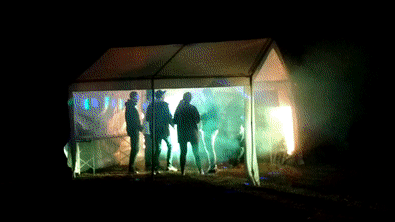

sound-to-light-osc (2.x)
========================

Real-time detection of beats with Python from an audio input device (typically "Stereo Mix"). Outputs OSC signals,
to be used for sound-to-light control.

It keeps track of the music "intensity" (calm, normal, intense) to switch lighting programs.

I use [QLC+](https://github.com/mcallegari/qlcplus) for DMX control.



Required modules
----------------

- Python 3.8+
- PyAudio
- PyQt5
- scipy
- python-osc

Install dependencies from `requirements.txt`:

```bash
pip install -r requirements.txt
```

Usage
-----

`python src\beat_detector.py`

OSC Signals
-----------

OSC signals are sent to `127.0.0.1:7701`, which can be changed in `src/beat_detector.py`.

- `/beat` is sent for every beat detected.
- `/bar` is sent to change the lighting scene.
- `/prog1` - `/prog8` is sent to change lighting programs (available have to be configured in `src/beat_detector.py`)

Technical Overview
------------------

The application is structured into several key components:

* `recorder.py`: Handles audio input from the system's default audio device, providing raw audio data and frequency
   spectrum (FFT) data for analysis.
* `analyzer.py`: Contains the core audio processing and detection logic:
  * `VolumeNormalizer`: Continuously normalizes the incoming audio volume to a target level.
  * `SpectralFluxBeatDetector`: Detects beats by analyzing the spectral flux in the low-frequency band.
  * `SpectralFluxIntensityDetector`: Determines the overall music intensity (Calm, Normal, Intense) by analyzing the
     spectral flux across the full frequency band. It uses hysteresis to prevent rapid state changes.
  * `NewSongDetector`: Identifies periods of silence to detect pauses and new song beginnings.
  * `AudioAnalyzer`: Orchestrates the various detectors, feeding them processed audio data.
  * `SignalGenerator`: Estimates BPM based on detected beats, tracks beat numbers, and generates the "bar" signals.
* `ui.py`: Implements the graphical user interface using PyQt5, providing real-time visualizations of spectral flux,
  beat and intensity thresholds, current BPM, and program status.
* `osc.py`: Manages the sending of Open Sound Control (OSC) messages to a specified IP address and port (default: `127.0.0.1:7701`).
* `beat_detector.py`: The main entry point of the application, integrating all components. It sets up the UI, audio
  recording, analysis, and OSC client. It also contains the logic for automatic program switching based on detected
  intensity and beat patterns.


Contributing
------------

Thanks for your interest in contributing to this project! Glad you like it 😊

I typically do not accept contributions to this project, as I've built this for myself and it just works fine for
me the way it is. The project isn't intended to work for anyone but myself. I've put it onto GitHub in case
someone finds this useful. So if you need changes, feel free to fork the repository and modify it for your own
needs.

If you have an idea that you believe is worth integrating, please reach out first. I don't want you to work on 
things that I wouldn't merge.

Acknowledgments
---------------

Based on [shunfu/python-beat-detector](https://github.com/shunfu/python-beat-detector).

Version History
---------------

### 2.0

- Fundamental rewrite for improved performance and accuracy.
- Audio analysis now runs every `0.02` seconds (50 times per second) for more responsive detection.
- Dynamic volume normalization ensures consistent detection regardless of input audio level.
- Uses spectral flux in the bass frequencies for beat tracking.
- Determines music intensity (Calm, Normal, Intense) by analyzing spectral flux across the entire frequency spectrum. 
  Applies hysteresis for stable state changes.
- New graphical interface to visualize beat and intensity detection, thresholds, and current BPM.

### 1.0

- Beat detection
- Automatic beat generation based on BPM
- Pause and new song detection

### 1.1

- Improved max volume calibration
- Improved pause detection
- Intensity detection
- Automatic lighting program switch

License
-------
This software is available under the [MIT license](LICENSE).

Support Me
----------
I love to hear from people using my work, it's giving me the motivation to keep working on it.

If you want to let me know you're finding it useful, please consider giving it a star ⭐ on GitHub.

If you love my work and want to say thank you, you can help me out for a beer 🍻️
[via PayPal](https://paypal.me/ChristianScheb).
